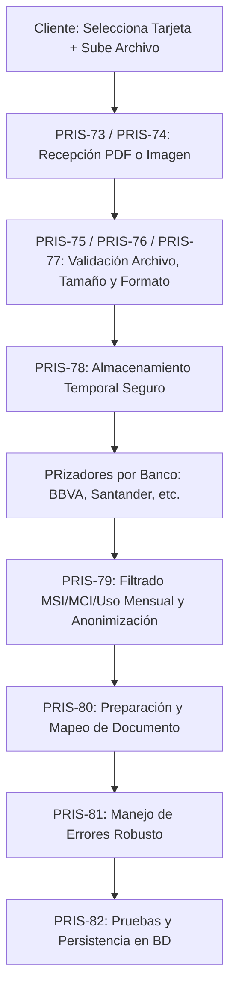

# Arquitectura e Implementación: Middleware de Recepción y Anonimización (TASK-07 / PRIS-72)

Este documento detalla el diseño técnico paso a paso para cumplir con los requerimientos de la tarea **PRIS-72**: recepción de estados de cuenta (PDF e imágenes), selección previa de tarjeta, parsing específico por banco, filtrado de datos financieros (MSI, MCI y uso mensual), anonimización y manejo de errores.

---

## 1. Flujo de Usuario y Experiencia (UX)
1. **Selección de Tarjeta:** El usuario entra a la sección de agregar transacciones/estado de cuenta y **selecciona primero la tarjeta** a la que pertenece el documento (ej. BBVA Terminación 1234, Santander, etc.). Esto envía el `tarjetaId` y el `banco` al backend.
2. **Carga de Archivo:** El usuario sube el archivo (PDF o fotografía/captura de pantalla).
3. **Procesamiento y Extracción:** El middleware procesa el archivo según el banco seleccionado.
4. **Resultado:** Se extraen únicamente los cargos de **uso mensual, MSI y MCI**, se anonimizan datos personales y se guardan en la base de datos vinculados a la tarjeta elegida.

---

## 2. Mapeo con las Tareas de Jira (PRIS-73 a PRIS-82)



---

## 3. Estrategia Técnica por Componente

### A. Selección de Tarjeta (Frontend & API Request)
En la app KMP, el usuario elige la tarjeta antes de enviar el multipart:
* **Endpoint Ktor:** `POST /api/v1/incomes/statements/upload` (o `/api/v1/cards/{cardId}/statements`)
* **Parámetros Multipart:**
  * `tarjetaId` (UUID)
  * `banco` (String: `"bbva"`, `"santander"`, `"citibanamex"`, etc.)
  * `archivo` (Binary PDF / Image)

### B. Recepción y Validación (`PRIS-73` a `PRIS-77`)
En Ktor (Servidor):
* **Recepción (`PRIS-73`, `PRIS-74`):** Usar `call.receiveMultipart()`.
* **Validación de Formato (`PRIS-77`):** Permitir solo `application/pdf`, `image/jpeg`, `image/png`.
* **Validación de Tamaño (`PRIS-76`):** Limitar a un máximo (ej. 10 MB) para prevenir ataques DoS o uso excesivo de memoria.

### C. Extracción de Texto: PDF vs. Imágenes (`PRIS-73`, `PRIS-74`)
* **Para PDFs:**
  * Utilizar una librería de extracción de texto en JVM como **Apache PDFBox** (`pdfbox`). Extrae texto plano directamente del PDF manteniendo la estructura de líneas.
* **Para Imágenes (OCR):**
  * Utilizar **Tesseract OCR** (mediante la librería `Tess4J` en Java/Kotlin) o integrar una API externa de OCR (Google Cloud Vision / AWS Textract). Tesseract es ideal para ejecución local en el servidor JVM.

### D. Patrón Strategy para los Bancos (Multi-Bank Parsers)
Como cada banco tiene un formato distinto, implementamos el patrón *Strategy*:

```kotlin
interface BankStatementParser {
    fun parseText(rawText: String): List<ExtractedTransaction>
}

class BbvaParser : BankStatementParser {
    override fun parseText(rawText: String): List<ExtractedTransaction> {
        // Regex específico para formato BBVA buscando MSI, MCI y cargos del mes
    }
}

class SantanderParser : BankStatementParser {
    override fun parseText(rawText: String): List<ExtractedTransaction> {
        // Regex específico para formato Santander
    }
}
```

### E. Filtrado Exclusivo: MSI, MCI y Uso Mensual (`PRIS-79`)
Mediante Expresiones Regulares (Regex), filtramos únicamente:
1. **Uso Mensual / Compras del Periodo:** Transacciones regulares con fecha, descripción y monto.
2. **MSI (Meses Sin Intereses):** Detectar patrones como `PAGO X/Y`, `MSI`, `MESES SIN INTERESES`.
3. **MCI (Meses Con Intereses):** Detectar patrones con tasa de interés o comisiones diferidas.
*Se ignoran saldos anteriores, pagos realizados, CLABEs, límites de crédito y datos no financieros.*

### F. Anonimización (`PRIS-79`)
Antes de almacenar o registrar logs:
* Enmascarar números de cuenta o tarjeta completos (ej. conservar solo los últimos 4 dígitos ya conocidos).
* Omitir nombres completos del cliente, direcciones y RFC si aparecen en el encabezado del estado de cuenta.

---

## 4. Próximos Pasos Recomendados para Implementación
1. Agregar dependencias en `server/build.gradle.kts` para PDFBox (`org.apache.pdfbox:pdfbox:3.0.1`) y Tess4J (si se usará OCR local).
2. Crear la interfaz `BankStatementParser` y los parsers iniciales para los bancos soportados.
3. Configurar las pruebas unitarias (`PRIS-82`) con archivos PDF/imagen de prueba simulados.
